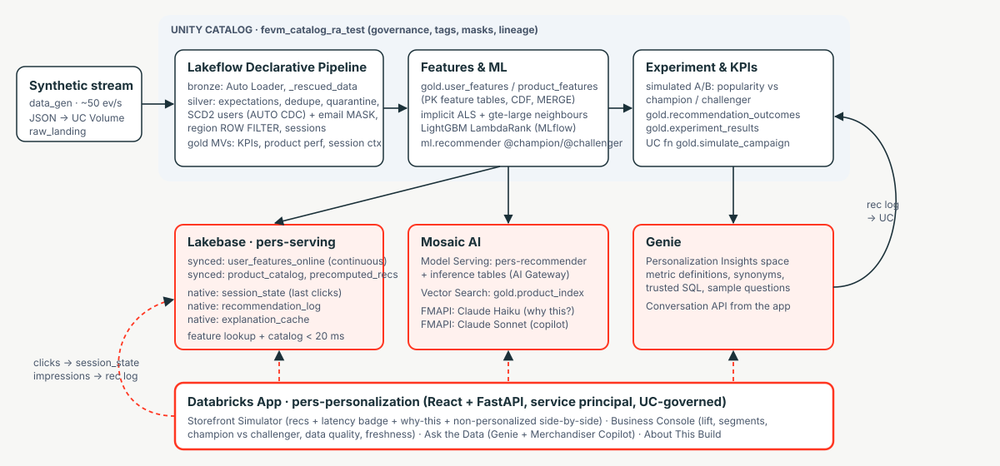
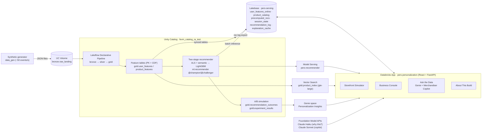

# Real-Time Personalization on Databricks

An online marketplace that serves every shopper the right product within ~100 ms of a page view, using what
they *just* clicked, with governance, explanations, and a business feedback loop. Everything runs on one
platform: no separate ML stack, serving database, or BI tool.

- Spec: [`docs/spec.md`](docs/spec.md)
- Trade-off log: [`docs/decisions.md`](docs/decisions.md)
- The four narrative answers: [`docs/about.md`](docs/about.md)
- **Customer demo script:** [`docs/demo.md`](docs/demo.md)
- **Review notebook:** [`notebooks/review.py`](notebooks/review.py) (run it as the `pers-review` job)

---

## 1. Use case

**Segment:** Digital Native Business. **Scenario:** an online marketplace / e-commerce retailer.

Digital-native retailers buy traffic through paid channels and lose most of it in the first session, because the
experience is one-size-fits-all:

| Problem | Effect |
|---|---|
| Same homepage rails for a first-time visitor and a loyal buyer | Low session-to-purchase conversion, high bounce |
| ~30% of sessions are **cold start** (no history) | These shoppers get "trending" at best |
| No explainability | Merchandisers can't see *why* a product was shown or whether it worked |
| Personalization logic lives in app code | It is disconnected from the governed analytics the business trusts |

**What this build delivers**

| Persona | What they get |
|---|---|
| Shopper | A personalized rail that reacts to the last click, with a one-line "why this?" note |
| Merchandising manager | Business Console (lift, segments, categories, champion vs challenger), Genie in plain English, and a Merchandiser Copilot that simulates campaigns |
| Data/ML engineer | One governed pipeline from raw events to served recommendations, with lineage, data-quality expectations and inference tables |
| Executive | Measured lift in CTR, conversion, cold-start conversion and AOV from a simulated A/B test |

**Targets (simulated A/B: popularity baseline vs personalized)**

| Metric | Baseline | Target |
|---|---|---|
| Recommendation CTR | ~3% | ≥ 6% |
| Session → purchase conversion | ~2.0% | ≥ 2.6% |
| Cold-start conversion | ~0.8% | ≥ 1.4% |
| AOV | — | +5–8% |
| Recommendation latency p95 | n/a | < 100 ms |

The synthetic world has hidden shopper preferences that the models never see. The A/B simulator draws clicks and
purchases from those preferences, so the lift comes from ranking quality and is not hard-coded.

---

## 2. Architecture





**Request path (one recommendation)**

1. The app reads the shopper's features (`serving.user_features_online`) and last 5 clicks (`app.session_state`) from Lakebase.
2. It calls Model Serving (`pers-recommender`, champion or challenger) with `user_id`, the session items, and the features.
3. The model generates up to 200 candidates (ALS item-item CF, gte-large semantic neighbours, and category/global popularity), then ranks them with LightGBM.
4. The app joins titles, prices and images from `serving.product_catalog`, logs impressions to `app.recommendation_log`, and returns a latency breakdown.
5. If serving is slow or unavailable (1.5 s timeout), the app serves `serving.precomputed_recs` instead: per-user recs first, then per-segment.
6. "Why this?" text loads asynchronously from Claude Haiku. The prompt contains only the feature payload, and each answer is cached per (user, product) in Lakebase.

---

## 3. Components

### Data & ingestion

| Component | Path | Description |
|---|---|---|
| Simulator | `data_gen/simulator.py` | 2k products (12 categories, brands, prices, quality, popularity prior) and 10k users across 8 personas (category affinity, price sensitivity, favourite brands). Simulates sessions with intent drift, a 30% cold-start cohort, and the response model for recommendation rails |
| Generator job | `data_gen/generate.py` | `backfill`: 28 days, ~45k sessions, ~356k events, users CDC, orders, ground truth in `ml.sim_user_truth`. `stream`: ~50 events/s with realistic dirt (nulls, bad types, duplicates, zero prices) |
| Lakeflow pipeline | `pipelines/bronze.py`, `silver.py`, `gold.py` | Auto Loader into bronze. Silver has expectations (`expect_or_drop`/`expect`), watermark dedupe, a quarantine table, SCD2 `users` via AUTO CDC with an email **column mask** and a region **row filter**, SCD1 products, and sessions. Gold MVs: `session_kpis_daily`, `product_performance`, `session_context` |

### Governance (Unity Catalog)

| Component | Path | Description |
|---|---|---|
| UC setup | `governance/setup_uc.py` | Schemas `bronze/silver/gold/ml/app/serving`, volumes `raw_landing`/`model_artifacts`, `silver.mask_email()`, `silver.users_region_filter()`, tags (`data_product`, `layer`, `sensitivity`, `pii=email`), group grants |
| App grants | `scripts/grant_app.py` | Least-privilege grants for the app service principal: UC schemas, serving endpoint, Genie space, Vector Search |

### Features & ML

| Component | Path | Description |
|---|---|---|
| Feature refresh | `features/build_features.py` | `gold.user_features` (RFM, category affinity, last-20 items, segment) and `gold.product_features`: PK feature tables with CDF, upserted by MERGE with a row hash. Also writes `gold.user_segments` and `gold.pipeline_health` (DQ + freshness) |
| Recommender core | `ml/recommender.py` | Implicit ALS (numpy/scipy), cosine neighbours, candidate generation, ranking features, and the MLflow pyfunc `RecommenderModel` |
| Training | `ml/train.py` | Temporal holdout, point-in-time training queries, LightGBM LambdaRank champion (base features) and challenger (+brand/price/loyalty), NDCG@10 / Recall@50 against popularity, registration to `ml.recommender` with aliases |
| Serving | `ml/deploy_serving.py` | Endpoint `pers-recommender`: champion at 100% traffic, challenger addressable by name, AI Gateway inference tables |
| Batch inference | `ml/batch_inference.py` | `gold.precomputed_recs`: per user, per acquisition channel, and global (the fallback path) |
| A/B simulation | `experiments/simulate_ab.py` | 14 days × 900 sessions/day, split 50% popularity / 25% champion / 25% challenger. Writes `gold.recommendation_outcomes` and `gold.experiment_results` |

### GenAI

| Component | Path | Description |
|---|---|---|
| Vector Search | `genai/vector_search_setup.py` | Endpoint `pers-vs` and delta-sync index `gold.product_index` with managed `databricks-gte-large-en` embeddings |
| Campaign tool | `genai/uc_functions.py` | UC table function `gold.simulate_campaign(category, segment, discount_pct)`: reach, expected conversion, incremental orders and revenue |
| Explanations | `app/backend/explain.py` | Grounded one-line "why this?" from Claude Haiku, cached in `app.explanation_cache` |
| Merchandiser Copilot | `app/backend/agent.py` | Tool-calling agent on Claude Sonnet with `ask_genie`, `simulate_campaign` and `lookup_product`, streamed over SSE with visible tool calls |
| Copilot evaluation | `genai/agent_eval.py` | MLflow GenAI evaluation on 20 golden questions with expected-tool, relevance and grounded-numbers scorers |

### Serving layer (Lakebase)

| Component | Path | Description |
|---|---|---|
| Lakebase project | `resources/serving_infra.yml` | Autoscaling project `pers-serving` (PG 17, 0.5–4 CU) |
| Synced tables | `lakebase/setup_lakebase.py` | `user_features_online` (continuous), `product_catalog` and `precomputed_recs` (triggered), all in Postgres schema `serving` |
| App-owned tables | `app/backend/db.py` | `app.session_state`, `app.recommendation_log`, `app.explanation_cache`. Async pool with OAuth token refresh |
| Rec log export | `lakebase/export_reclog.py` | Incremental reverse-sync to `gold.recommendation_log` |

### Analytics

| Component | Path | Description |
|---|---|---|
| Genie space | `genie/create_space.py` | "Personalization Insights" over 5 gold tables, with metric definitions, synonyms, join specs, trusted SQL and 5 sample questions |

### Databricks App

| Component | Path | Description |
|---|---|---|
| Backend | `app/backend/` | FastAPI routes: `/api/recs`, `/events`, `/explain`, `/shoppers`, `/products`, `/similar`, `/kpis/*`, `/pipeline`, `/genie`, `/agent` (SSE), `/about`, `/health`, `/img`. Also serves the React build |
| Frontend | `app/frontend/` | React + Vite + TypeScript, MUI, Recharts, React Query |
| Storefront Simulator | `pages/Storefront.tsx` | Pick or create a shopper, browse, click. Shows recs with a latency badge, champion/challenger toggle, the non-personalized side-by-side, "why this?" notes, Vector Search "similar items", and a live session timeline |
| Business Console | `pages/Console.tsx` | KPI lift cards, daily CTR, segments, categories, champion vs challenger (offline and online), organic funnel, data quality, freshness, live p50/p95 |
| Ask the Data | `pages/Ask.tsx` | Genie chat (SQL and results) and Merchandiser Copilot (streamed tool calls) |
| About This Build | `pages/About.tsx` | The four questions, the architecture, the build log rendered from `docs/decisions.md`, the spec, and deep links to every asset |

### Orchestration (bundle)

| Job / resource | Description |
|---|---|
| `pers-setup` | One-time bootstrap: UC → backfill → pipeline → features → train → serving / Vector Search / batch recs → A/B → UC functions → Lakebase sync → Genie → grants |
| `pers-event-stream` | Live event stream for a demo window (`minutes`, `rate` parameters) |
| `pers-refresh` | Hourly (paused): pipeline → features → Lakebase sync → rec log export |
| `pers-retrain` | Weekly (paused): retrain → roll the endpoint → batch recs → A/B → sync |
| `pers-agent-eval` | Copilot evaluation |
| `pers-experiment` | Re-run the A/B simulation and refresh the campaign UC function |
| `pers-review` | Runs the review notebook: job status, volumes, bronze/silver/gold samples, Lakebase rows, live endpoint and Vector Search queries, Genie answers |
| `pers-personalization-pipeline` | Serverless Lakeflow pipeline (`pipeline_continuous` variable) |

---

## 4. Deploy

```bash
cp .env.example .env && vi .env                 # profile + warehouse id (git-ignored)
scripts/deploy.sh "$DATABRICKS_CONFIG_PROFILE" dev      # build app → bundle deploy → pers-setup → start app
```

Or step by step:

```bash
set -a; source .env; set +a                          # profile + BUNDLE_VAR_warehouse_id
scripts/build_app.sh                                  # React → app/backend/static; docs → app/backend/content
databricks bundle deploy -p $DATABRICKS_CONFIG_PROFILE               # pipeline, jobs, Lakebase project, VS endpoint, app
databricks bundle run pers_app -p $DATABRICKS_CONFIG_PROFILE         # start the app first so its SP owns the Lakebase `app` schema
databricks bundle run pers_setup -p $DATABRICKS_CONFIG_PROFILE       # the one setup job
```

**Demo window:** set `pipeline_continuous: true` in `databricks.yml`, redeploy, and run `pers-event-stream`.

**Key bundle variables:** `catalog`, `warehouse_id`, `lakebase_project`, `serving_endpoint`, `vs_endpoint`,
`explain_llm`, `agent_llm`, `pipeline_continuous`, `serving_scale_to_zero`.

## 5. Local development

```bash
cp .env.example .env   # then fill in your profile / warehouse id
set -a; source .env; set +a
uv venv .venv && uv pip install -r app/requirements.txt numpy pandas scipy pytest
.venv/bin/python -m pytest tests                                       # simulator + recommender logic
cd app && ../.venv/bin/uvicorn backend.main:app --reload   # API on :8000
cd app/frontend && npm run dev                                         # UI on :5173, proxies /api
```

## 6. Repository layout

```
databricks.yml, resources/   bundle: pipeline, jobs, Lakebase project, Vector Search endpoint, app
data_gen/                    simulator + generator job
pipelines/                   Lakeflow Declarative Pipeline (bronze, silver, gold)
governance/                  UC schemas, volumes, masks, row filters, tags, grants
features/                    feature tables, segments, pipeline health
ml/                          recommender core, training, batch inference, serving
genai/                       Vector Search, UC tool functions, copilot evaluation
lakebase/                    synced tables + grants, rec log export
genie/                       Genie space definition
experiments/                 simulated A/B test
app/                         FastAPI backend + React frontend
notebooks/                   review notebook (read-only walkthrough of every layer)
docs/                        spec, decisions, about, demo script, architecture.svg
scripts/                     build, deploy, reset, app grants
tests/                       local tests
```
